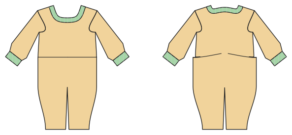

# Baby-Strampler

*English version: [README.en.md](README.en.md)*

Strampler (Gr. 50–92) mit Druckknöpfen an den Beininnenseiten, Bündchen oder Füßen.

Modul: `romper` · Beispielbild: Größe 68

## Beispiel-Prompts für alle Optionen

| Option | Prompt |
|---|---|
| `feet` | *„Einen Strampler mit Füßen, Größe 68.“* |
| `sleeve_length = short, long` | *„Kurzarm-Strampler für den Sommer, Größe 62.“* |
| `fabric = jersey, interlock, fleece` | *„Strampler aus Interlock.“* |

## Geht bei jedem Kleidungsstück

| Angabe | Prompt |
|---|---|
| fabric, stretch | *… aus Jersey mit 40 % Dehnung.* |
| Größe oder Maße | *… für mich: Brust 96, Taille 80, Hüfte 102, Größe 168.* |
| Druck | *… auf A4 zum Kleben / auf der 24"-Rolle / als A0.* |
| Maschinen | *… ich nähe nur mit der Overlock.* |
| Sprache | *… Anleitung auf Deutsch.* |

Alle Optionen mit Werten: [references/options.md](../../../references/options.md).
