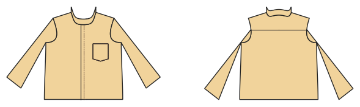

# Shirt and blouse

*Deutsche Version: [README.md](README.md)*

Woven shirt with button stand, collar and stand, yoke, cuffs with sleeve placket, chest pocket; blouse with bust dart.

Module: `shirt` · Picture: men's size 52

## Example prompts for every option

| Option | Prompt |
|---|---|
| `style = shirt, blouse` | *"A blouse for me, size 40."* |
| `collar = shirt, stand, peter_pan, none` | *"A girl's blouse with a Peter Pan collar, size 110."* |
| `sleeve_length = short, long` | *"Short-sleeve shirt in men's 52."* |
| `yoke, pocket, bust_dart, cuffs` | *"Shirt without chest pocket and yoke."* |
| `buttons` | *"Blouse with 7 buttons."* |

## Works for every garment

| What | Prompt |
|---|---|
| fabric, stretch | *… from jersey with 40 % stretch.* |
| size or measurements | *… for me: chest 96, waist 80, hip 102, height 168.* |
| printing | *… as A4 pages / on the 24" roll / as A0.* |
| machines | *… I only sew with an overlocker.* |
| language | *… instructions in English.* |

All options with their values: [references/options.md](../../../references/options.md).
