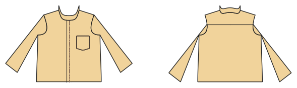

# Hemd und Bluse

*English version: [README.en.md](README.en.md)*

Gewebtes Hemd mit Knopfleiste, Kragen mit Steg, Passe, Manschetten mit Ärmelschlitz, Brusttasche; Bluse mit Brustabnäher.

Modul: `shirt` · Beispielbild: Herrengröße 52

## Beispiel-Prompts für alle Optionen

| Option | Prompt |
|---|---|
| `style = shirt, blouse` | *„Eine Bluse für mich, Größe 40.“* |
| `collar = shirt, stand, peter_pan, none` | *„Eine Kinderbluse mit Bubikragen, Größe 110.“* |
| `sleeve_length = short, long` | *„Kurzarmhemd in Herrengröße 52.“* |
| `yoke, pocket, bust_dart, cuffs` | *„Hemd ohne Brusttasche und ohne Passe.“* |
| `buttons` | *„Bluse mit 7 Knöpfen.“* |

## Geht bei jedem Kleidungsstück

| Angabe | Prompt |
|---|---|
| fabric, stretch | *… aus Jersey mit 40 % Dehnung.* |
| Größe oder Maße | *… für mich: Brust 96, Taille 80, Hüfte 102, Größe 168.* |
| Druck | *… auf A4 zum Kleben / auf der 24"-Rolle / als A0.* |
| Maschinen | *… ich nähe nur mit der Overlock.* |
| Sprache | *… Anleitung auf Deutsch.* |

Alle Optionen mit Werten: [references/options.md](../../../references/options.md).
