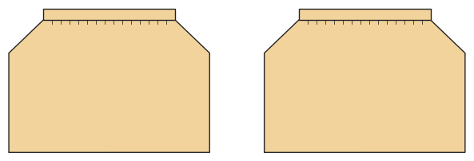

# Skirt

*Deutsche Version: [README.md](README.md)*

Skirt with elastic waist: gathered, A-line or circle.

Module: `skirt` · Picture: size 128

## Example prompts for every option

| Option | Prompt |
|---|---|
| `style = gathered, a_line, circle` | *"A circle skirt in 128."* |
| `length = mini, knee, midi, maxi` | *"A maxi skirt for me, size 38."* |
| `gather` | *"A gathered skirt with little fullness (1.3)."* |
| `flare_deg` | *"An A-line skirt with more flare."* |

## Works for every garment

| What | Prompt |
|---|---|
| fabric, stretch | *… from jersey with 40 % stretch.* |
| size or measurements | *… for me: chest 96, waist 80, hip 102, height 168.* |
| printing | *… as A4 pages / on the 24" roll / as A0.* |
| machines | *… I only sew with an overlocker.* |
| language | *… instructions in English.* |

All options with their values: [references/options.md](../../../references/options.md).
