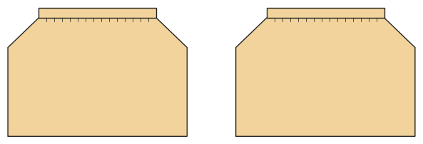

# Rock

*English version: [README.en.md](README.en.md)*

Rock mit Gummibund: gezogen, A-Linie oder Tellerrock.

Modul: `skirt` · Beispielbild: Größe 128

## Beispiel-Prompts für alle Optionen

| Option | Prompt |
|---|---|
| `style = gathered, a_line, circle` | *„Einen Tellerrock in 128.“* |
| `length = mini, knee, midi, maxi` | *„Einen Maxirock für mich, Größe 38.“* |
| `gather` | *„Ein Stufenrock mit wenig Kräuselung (1,3).“* |
| `flare_deg` | *„A-Linien-Rock mit mehr Weite.“* |

## Geht bei jedem Kleidungsstück

| Angabe | Prompt |
|---|---|
| fabric, stretch | *… aus Jersey mit 40 % Dehnung.* |
| Größe oder Maße | *… für mich: Brust 96, Taille 80, Hüfte 102, Größe 168.* |
| Druck | *… auf A4 zum Kleben / auf der 24"-Rolle / als A0.* |
| Maschinen | *… ich nähe nur mit der Overlock.* |
| Sprache | *… Anleitung auf Deutsch.* |

Alle Optionen mit Werten: [references/options.md](../../../references/options.md).
