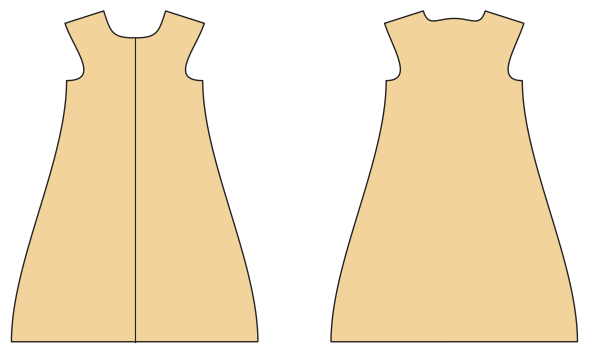

# Baby sleeping bag and swaddle sack

*Deutsche Version: [README.md](README.md)*

Lined, two-way zip; warmth by TOG (wadding); swaddle sack with wings and Velcro.

Module: `sleeping_bag` · Picture: size 74

## Example prompts for every option

| Option | Prompt |
|---|---|
| `style = sleeping_bag, swaddle` | *"A swaddle sack for a newborn (size 56)."* |
| `tog = 0.5, 1.0, 2.5` | *"A winter sleeping bag (2.5 TOG) in 86."* |
| `fabric` | *"A muslin (woven) sleeping bag for summer."* |

## Works for every garment

| What | Prompt |
|---|---|
| fabric, stretch | *… from jersey with 40 % stretch.* |
| size or measurements | *… for me: chest 96, waist 80, hip 102, height 168.* |
| printing | *… as A4 pages / on the 24" roll / as A0.* |
| machines | *… I only sew with an overlocker.* |
| language | *… instructions in English.* |

All options with their values: [references/options.md](../../../references/options.md).
