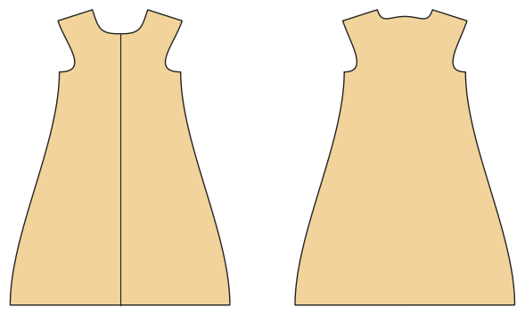

# Baby-Schlafsack und Pucksack

*English version: [README.en.md](README.en.md)*

Gefüttert, Zwei-Wege-Reißverschluss; Wärme nach TOG (Wattierung); Pucksack mit Flügeln und Klett.

Modul: `sleeping_bag` · Beispielbild: Größe 74

## Beispiel-Prompts für alle Optionen

| Option | Prompt |
|---|---|
| `style = sleeping_bag, swaddle` | *„Einen Pucksack für ein Neugeborenes (Größe 56).“* |
| `tog = 0.5, 1.0, 2.5` | *„Einen Winterschlafsack (2,5 TOG) in 86.“* |
| `fabric` | *„Schlafsack aus Musselin (Webware) für den Sommer.“* |

## Geht bei jedem Kleidungsstück

| Angabe | Prompt |
|---|---|
| fabric, stretch | *… aus Jersey mit 40 % Dehnung.* |
| Größe oder Maße | *… für mich: Brust 96, Taille 80, Hüfte 102, Größe 168.* |
| Druck | *… auf A4 zum Kleben / auf der 24"-Rolle / als A0.* |
| Maschinen | *… ich nähe nur mit der Overlock.* |
| Sprache | *… Anleitung auf Deutsch.* |

Alle Optionen mit Werten: [references/options.md](../../../references/options.md).
