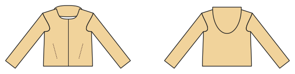

# Softshell / outdoor jacket

*Deutsche Version: [README.md](README.md)*

Zip, hood, zip pockets, Velcro sleeve tabs, drawcord hem.

Module: `softshell` · Picture: size 128

## Example prompts for every option

| Option | Prompt |
|---|---|
| `hood` | *"Softshell jacket without hood, size 140."* |
| `pockets` | *"Softshell jacket without pockets."* |
| `cuff_tabs` | *"Without the Velcro sleeve tabs."* |
| `hem_drawcord` | *"Without the drawcord hem."* |

## Works for every garment

| What | Prompt |
|---|---|
| fabric, stretch | *… from jersey with 40 % stretch.* |
| size or measurements | *… for me: chest 96, waist 80, hip 102, height 168.* |
| printing | *… as A4 pages / on the 24" roll / as A0.* |
| machines | *… I only sew with an overlocker.* |
| language | *… instructions in English.* |

All options with their values: [references/options.md](../../../references/options.md).
