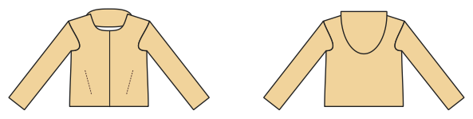

# Softshelljacke / Outdoorjacke

*English version: [README.en.md](README.en.md)*

Reißverschluss, Kapuze, Reißverschlusstaschen, Klettriegel an den Ärmeln, Tunnelzug im Saum.

Modul: `softshell` · Beispielbild: Größe 128

## Beispiel-Prompts für alle Optionen

| Option | Prompt |
|---|---|
| `hood` | *„Softshelljacke ohne Kapuze, Größe 140.“* |
| `pockets` | *„Softshelljacke ohne Taschen.“* |
| `cuff_tabs` | *„Ohne Klettriegel an den Ärmeln.“* |
| `hem_drawcord` | *„Ohne Tunnelzug im Saum.“* |

## Geht bei jedem Kleidungsstück

| Angabe | Prompt |
|---|---|
| fabric, stretch | *… aus Jersey mit 40 % Dehnung.* |
| Größe oder Maße | *… für mich: Brust 96, Taille 80, Hüfte 102, Größe 168.* |
| Druck | *… auf A4 zum Kleben / auf der 24"-Rolle / als A0.* |
| Maschinen | *… ich nähe nur mit der Overlock.* |
| Sprache | *… Anleitung auf Deutsch.* |

Alle Optionen mit Werten: [references/options.md](../../../references/options.md).
