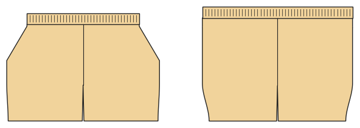

# Swim trunks

*Deutsche Version: [README.md](README.md)*

Quick-dry fabric, elastic waistband with a drawcord through eyelets, mesh pocket bags, mesh brief liner.

Module: `swim_trunks` · Picture: men's size 52

## Example prompts for every option

| Option | Prompt |
|---|---|
| `length = short, knee` | *"Knee-length swim trunks, size 52."* |
| `liner` | *"Swim trunks without liner for my child, 128."* |
| `pockets` | *"Swim trunks with a back pocket."* |

## Works for every garment

| What | Prompt |
|---|---|
| fabric, stretch | *… from jersey with 40 % stretch.* |
| size or measurements | *… for me: chest 96, waist 80, hip 102, height 168.* |
| printing | *… as A4 pages / on the 24" roll / as A0.* |
| machines | *… I only sew with an overlocker.* |
| language | *… instructions in English.* |

All options with their values: [references/options.md](../../../references/options.md).
