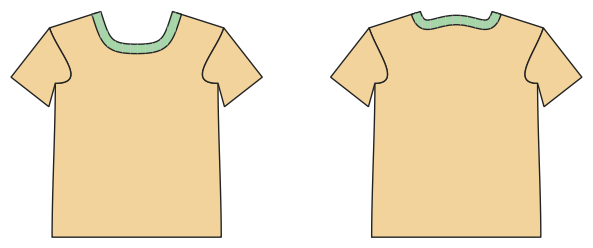

# T-shirt and long-sleeve top

*Deutsche Version: [README.md](README.md)*

The top block: set-in or raglan sleeves, round or V neck, bands.

Module: `tshirt_basic` · Picture: size 128

## Example prompts for every option

| Option | Prompt |
|---|---|
| `sleeve_style = set_in, raglan` | *"A raglan top in 140."* |
| `sleeve_length = short, 3/4, long` | *"A long-sleeve top in 110."* |
| `neckline = round, v` | *"V-neck T-shirt for me, men's 50."* |
| `fit = slim, normal, wide, oversized, boxy` | *"An oversized tee in 152."* |
| `length = normal, tunic` | *"A tunic top in 122."* |
| `sleeve_cuffs, hem_band` | *"Long-sleeve top with cuffs and a hem band."* |
| `style_lines = princess, yoke, color_block` | *"A colour-block tee: the top part in another colour."* |

## Works for every garment

| What | Prompt |
|---|---|
| fabric, stretch | *… from jersey with 40 % stretch.* |
| size or measurements | *… for me: chest 96, waist 80, hip 102, height 168.* |
| printing | *… as A4 pages / on the 24" roll / as A0.* |
| machines | *… I only sew with an overlocker.* |
| language | *… instructions in English.* |

All options with their values: [references/options.md](../../../references/options.md).
