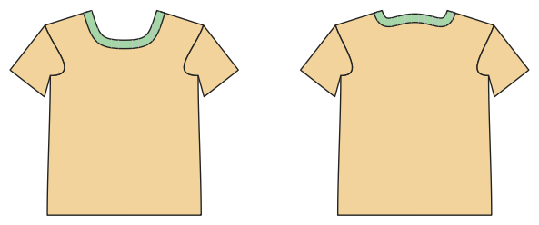

# T-Shirt und Langarmshirt

*English version: [README.en.md](README.en.md)*

Der Oberteil-Grundschnitt: eingesetzte oder Raglanärmel, Rundhals oder V-Ausschnitt, Bündchen.

Modul: `tshirt_basic` · Beispielbild: Größe 128

## Beispiel-Prompts für alle Optionen

| Option | Prompt |
|---|---|
| `sleeve_style = set_in, raglan` | *„Ein Raglanshirt in 140.“* |
| `sleeve_length = short, 3/4, long` | *„Ein Langarmshirt in 110.“* |
| `neckline = round, v` | *„T-Shirt mit V-Ausschnitt für mich, Herrengröße 50.“* |
| `fit = slim, normal, wide, oversized, boxy` | *„Ein Oversize-Shirt in 152.“* |
| `length = normal, tunic` | *„Ein Tunika-Shirt in 122.“* |
| `sleeve_cuffs, hem_band` | *„Langarmshirt mit Bündchen an Ärmeln und Saum.“* |
| `style_lines = princess, yoke, color_block` | *„T-Shirt mit Colour-Blocking: oben eine andere Farbe.“* |

## Geht bei jedem Kleidungsstück

| Angabe | Prompt |
|---|---|
| fabric, stretch | *… aus Jersey mit 40 % Dehnung.* |
| Größe oder Maße | *… für mich: Brust 96, Taille 80, Hüfte 102, Größe 168.* |
| Druck | *… auf A4 zum Kleben / auf der 24"-Rolle / als A0.* |
| Maschinen | *… ich nähe nur mit der Overlock.* |
| Sprache | *… Anleitung auf Deutsch.* |

Alle Optionen mit Werten: [references/options.md](../../../references/options.md).
