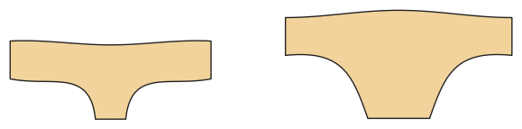

# Underwear: briefs and boxers

*Deutsche Version: [README.md](README.md)*

Briefs with a lined gusset (burrito method) and elastic at waist and legs, or boxer briefs.

Module: `underwear` · Picture: women's size 38

## Example prompts for every option

| Option | Prompt |
|---|---|
| `style = briefs, boxers` | *"Boxer briefs for my husband, size 52."* |
| `leg_cut = normal, high, low` | *"Briefs with a high leg cut."* |
| `rise = mid, low` | *"Low-rise briefs."* |
| `leg_length` | *"Boxers with 15 cm leg length."* |

## Works for every garment

| What | Prompt |
|---|---|
| fabric, stretch | *… from jersey with 40 % stretch.* |
| size or measurements | *… for me: chest 96, waist 80, hip 102, height 168.* |
| printing | *… as A4 pages / on the 24" roll / as A0.* |
| machines | *… I only sew with an overlocker.* |
| language | *… instructions in English.* |

All options with their values: [references/options.md](../../../references/options.md).
