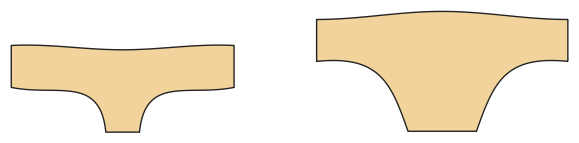

# Unterwäsche: Slip und Boxershorts

*English version: [README.en.md](README.en.md)*

Slip mit gefüttertem Zwickel (Burrito-Methode) und Gummi an Bund und Bein, oder Boxershorts.

Modul: `underwear` · Beispielbild: Damengröße 38

## Beispiel-Prompts für alle Optionen

| Option | Prompt |
|---|---|
| `style = briefs, boxers` | *„Boxershorts für meinen Mann, Größe 52.“* |
| `leg_cut = normal, high, low` | *„Slip mit hohem Beinausschnitt.“* |
| `rise = mid, low` | *„Hüftslip (tiefe Leibhöhe).“* |
| `leg_length` | *„Boxershorts mit 15 cm Beinlänge.“* |

## Geht bei jedem Kleidungsstück

| Angabe | Prompt |
|---|---|
| fabric, stretch | *… aus Jersey mit 40 % Dehnung.* |
| Größe oder Maße | *… für mich: Brust 96, Taille 80, Hüfte 102, Größe 168.* |
| Druck | *… auf A4 zum Kleben / auf der 24"-Rolle / als A0.* |
| Maschinen | *… ich nähe nur mit der Overlock.* |
| Sprache | *… Anleitung auf Deutsch.* |

Alle Optionen mit Werten: [references/options.md](../../../references/options.md).
