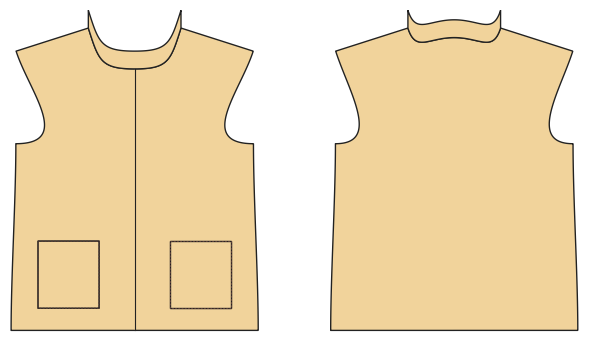

# Vest / gilet

*Deutsche Version: [README.md](README.md)*

Sleeveless, zip, snaps or pullover; collar, pockets, bound armholes.

Module: `vest` · Picture: size 128

## Example prompts for every option

| Option | Prompt |
|---|---|
| `closure = zip, snaps, none` | *"A fleece vest with snaps in 128."* |
| `collar` | *"Vest without collar."* |
| `pockets` | *"Vest without pockets."* |
| `binding_fabric = main, rib` | *"Vest with rib binding."* |

## Works for every garment

| What | Prompt |
|---|---|
| fabric, stretch | *… from jersey with 40 % stretch.* |
| size or measurements | *… for me: chest 96, waist 80, hip 102, height 168.* |
| printing | *… as A4 pages / on the 24" roll / as A0.* |
| machines | *… I only sew with an overlocker.* |
| language | *… instructions in English.* |

All options with their values: [references/options.md](../../../references/options.md).
