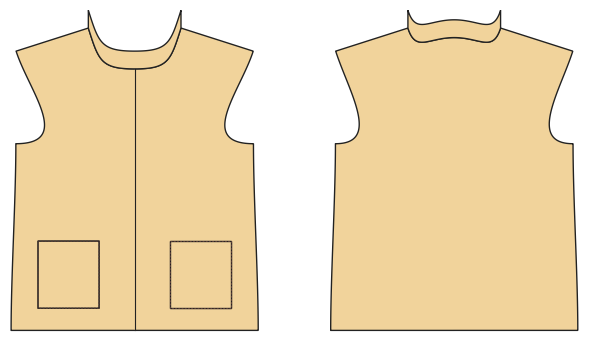

# Weste / Gilet

*English version: [README.en.md](README.en.md)*

Ärmellos, Reißverschluss, Druckknöpfe oder zum Überziehen; Kragen, Taschen, Armausschnitt mit Einfassung.

Modul: `vest` · Beispielbild: Größe 128

## Beispiel-Prompts für alle Optionen

| Option | Prompt |
|---|---|
| `closure = zip, snaps, none` | *„Eine Fleeceweste mit Druckknöpfen in 128.“* |
| `collar` | *„Weste ohne Kragen.“* |
| `pockets` | *„Weste ohne Taschen.“* |
| `binding_fabric = main, rib` | *„Weste mit Bündchen-Einfassung.“* |

## Geht bei jedem Kleidungsstück

| Angabe | Prompt |
|---|---|
| fabric, stretch | *… aus Jersey mit 40 % Dehnung.* |
| Größe oder Maße | *… für mich: Brust 96, Taille 80, Hüfte 102, Größe 168.* |
| Druck | *… auf A4 zum Kleben / auf der 24"-Rolle / als A0.* |
| Maschinen | *… ich nähe nur mit der Overlock.* |
| Sprache | *… Anleitung auf Deutsch.* |

Alle Optionen mit Werten: [references/options.md](../../../references/options.md).
