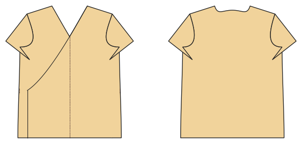

# Wrap top and wrap dress

*Deutsche Version: [README.md](README.md)*

Knit, crossed fronts, band along the wrap edge, ties.

Module: `wrap` · Picture: women's size 38

## Example prompts for every option

| Option | Prompt |
|---|---|
| `style = top, dress` | *"A jersey wrap dress, size 38."* |
| `sleeve_length = short, long` | *"Wrap top with long sleeves."* |
| `overlap` | *"Wrap top with less overlap (0.7)."* |

## Works for every garment

| What | Prompt |
|---|---|
| fabric, stretch | *… from jersey with 40 % stretch.* |
| size or measurements | *… for me: chest 96, waist 80, hip 102, height 168.* |
| printing | *… as A4 pages / on the 24" roll / as A0.* |
| machines | *… I only sew with an overlocker.* |
| language | *… instructions in English.* |

All options with their values: [references/options.md](../../../references/options.md).
