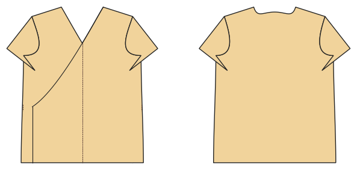

# Wickeltop und Wickelkleid

*English version: [README.en.md](README.en.md)*

Jersey, die Vorderteile kreuzen sich, Blende entlang der Wickelkante, Bindebänder.

Modul: `wrap` · Beispielbild: Damengröße 38

## Beispiel-Prompts für alle Optionen

| Option | Prompt |
|---|---|
| `style = top, dress` | *„Ein Wickelkleid aus Jersey, Größe 38.“* |
| `sleeve_length = short, long` | *„Wickeltop mit langen Ärmeln.“* |
| `overlap` | *„Wickeltop mit weniger Überlappung (0,7).“* |

## Geht bei jedem Kleidungsstück

| Angabe | Prompt |
|---|---|
| fabric, stretch | *… aus Jersey mit 40 % Dehnung.* |
| Größe oder Maße | *… für mich: Brust 96, Taille 80, Hüfte 102, Größe 168.* |
| Druck | *… auf A4 zum Kleben / auf der 24"-Rolle / als A0.* |
| Maschinen | *… ich nähe nur mit der Overlock.* |
| Sprache | *… Anleitung auf Deutsch.* |

Alle Optionen mit Werten: [references/options.md](../../../references/options.md).
